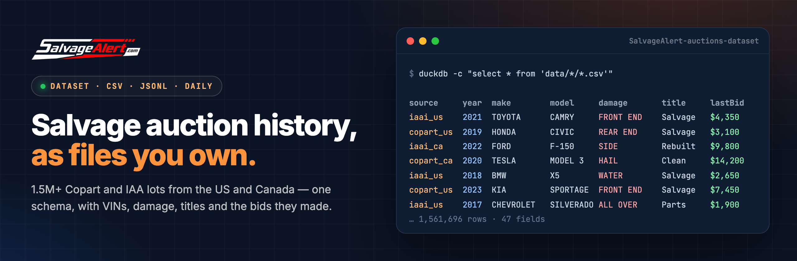

<div align="center">

<a href="https://salvagealert.com/datasets?utm_source=github&utm_medium=dataset_readme">
  
</a>

<br><br>

**The free daily sample of the [SalvageAlert](https://salvagealert.com/?utm_source=github&utm_medium=dataset_readme) salvage auction dataset.**

Every Copart and IAA lot in the US and Canada — vehicle, damage, title, sale date, yard and the bids it made — in one schema
across four auctions. A fresh slice lands here every day; the full 1.68M-lot history is one click away.

<br>

[](https://salvagealert.com/datasets?utm_source=github&utm_medium=dataset_readme)
[](#-coverage)
[](#-fields)
[](data)
[](LICENSE)

<br>

[**Build the full dataset**](https://salvagealert.com/datasets?utm_source=github&utm_medium=dataset_readme) &nbsp;·&nbsp;
[**Quick start**](#-quick-start) &nbsp;·&nbsp;
[**Coverage**](#-coverage) &nbsp;·&nbsp;
[**Fields**](#-fields) &nbsp;·&nbsp;
[**Pricing**](#-full-dataset-and-pricing) &nbsp;·&nbsp;
[**Live API**](https://salvagealert.com/developers?utm_source=github&utm_medium=dataset_readme)

</div>

<br>

## Contents

- [Why this dataset](#-why-this-dataset)
- [Quick start](#-quick-start)
- [Coverage](#-coverage)
- [What is in this repository](#-what-is-in-this-repository)
- [Fields](#-fields)
- [Today's sample at a glance](#-todays-sample-at-a-glance)
- [Use cases](#-use-cases)
- [Full dataset and pricing](#-full-dataset-and-pricing)
- [Dataset or API?](#-dataset-or-api)
- [FAQ](#-faq)
- [Licence and citation](#-licence-and-citation)

<br>

## ✦ Why this dataset

<table>
<tr>
<td width="33%" valign="top">

### One schema, four auctions
Copart USA, Copart Canada, IAA USA and IAA Canada in the same 47 columns. A Copart row and an IAA row join without mapping two feeds.

</td>
<td width="33%" valign="top">

### Outcomes, not just listings
**1,364,572** lots that already sold or ended, with the last bid, the retail value and the repair estimate the auction published.

</td>
<td width="33%" valign="top">

### Full VINs
**964,637** lots carry the complete, unmasked VIN — the key to joining history, recalls and your own records.

</td>
</tr>
<tr>
<td width="33%" valign="top">

### Every lot linked
Each row points to its page on SalvageAlert: every photo, the sale history of the VIN across auctions, and the bids.

</td>
<td width="33%" valign="top">

### Fresh every day
This repository is regenerated daily from the live catalogue. The full dataset grows by thousands of lots a day.

</td>
<td width="33%" valign="top">

### Priced to be used
From **$0.50 per 1,000 rows**, cheaper as the file grows, paid once. A free 100-row preview of any selection before you pay.

</td>
</tr>
</table>

<br>

## 🚀 Quick start

**1. Grab a day straight from GitHub**

```bash
curl -O https://raw.githubusercontent.com/SalvageAlert/SalvageAlert-auctions-dataset/main/data/copart_us/2026-10-30.csv
curl -O https://raw.githubusercontent.com/SalvageAlert/SalvageAlert-auctions-dataset/main/data/iaai_us/2026-10-30.csv
```

**2. Load everything in this repository**

```python
import glob, pandas as pd

df = pd.concat(map(pd.read_csv, glob.glob("data/*/*.csv")), ignore_index=True)
df.groupby(["auction", "country"]).size()
df[df.runsDrives == True].make.value_counts().head(10)
```

```sql
-- DuckDB
SELECT auction, primaryDamage, count(*) AS lots
FROM read_csv_auto('data/*/*.csv')
GROUP BY ALL ORDER BY lots DESC LIMIT 20;
```

**3. Need more than a sample?** [Build the full dataset](https://salvagealert.com/datasets?utm_source=github&utm_medium=dataset_readme): pick auctions, period, makes and years, see the price, preview 100 rows free.

<br>

## 🌍 Coverage

What SalvageAlert holds today — every row of it available in the [full dataset](https://salvagealert.com/datasets?utm_source=github&utm_medium=dataset_readme):

| Auction | `source` | Lots | Sold or ended | Full VIN | Recorded since | Days here |
|---|---|---:|---:|---:|---|---:|
| Copart USA | `copart_us` | 827,913 | 691,726 | 823,447 | 2026-05-30 | 6 |
| Copart Canada | `copart_ca` | 22,280 | 19,402 | 22,085 | 2026-08-15 | 6 |
| IAA USA | `iaai_us` | 695,436 | 523,769 | 0 | 2026-06-04 | 6 |
| IAA Canada | `iaai_ca` | 134,165 | 129,675 | 119,105 | 2026-05-27 | 6 |
| **All four** | | **1,679,794** | **1,364,572** | **964,637** | | |

<sub>IAA USA publishes masked VINs only; Copart publishes them in full. Counts are as of 2026-10-30.</sub>

<br>

## 📁 What is in this repository

```
data/
├── copart_us/2026-10-30.csv    one file per auction per day:
├── copart_ca/2026-10-30.csv    the lots whose sale fell on that day,
├── iaai_us/2026-10-30.csv      up to 1,000 rows each
└── iaai_ca/2026-10-30.csv
schema/fields.json          the schema, machine-readable
```

- **Today:** Copart USA **1,000** · Copart Canada **135** · IAA USA **1,000** · IAA Canada **1,000** — 3,135 rows.
- **Retention:** the last 30 days. Older days live on in the [full dataset](https://salvagealert.com/datasets?utm_source=github&utm_medium=dataset_readme).
- **Masking:** fields marked 🔒 read `[PREMIUM]`; the VIN keeps its first 11 characters (maker, model, year, plant) and masks the serial. Every paid file carries all of them.

<br>

## 📚 Fields

47 fields, identical for every auction. Dates are ISO 8601 UTC; prices are in the row's `currency` (USD or CAD).

<details open>
<summary><b>Show the 47 fields</b></summary>

<br>

| Field | Type | Sample | Description |
|---|---|:---:|---|
| `recordId` | string | ✓ | Stable id of the lot across files: `<source>:<lotNumber>`. |
| `source` | string | ✓ | copart_us, copart_ca, iaai_us or iaai_ca. |
| `auction` | string | ✓ | Copart or IAA. |
| `country` | string | ✓ | US or CA. |
| `lotNumber` | string | ✓ | The auction's lot (Copart) or stock (IAA) number. |
| `vin` | string | 🔒 | The full 17-character VIN when we hold it unmasked, otherwise the masked VIN the auction published. The free sample shows the first 11 characters (make, model, year, plant) and masks the serial. |
| `vinIsFull` | boolean | ✓ | Whether `vin` is the full, unmasked VIN. |
| `year` | integer | ✓ | Model year. |
| `make` | string | ✓ | Make, as the auction spells it. |
| `model` | string | ✓ | Model. |
| `trim` | string | ✓ | Trim level, when published. |
| `bodyStyle` | string | ✓ | Body style. |
| `vehicleType` | string | ✓ | Vehicle type code or name. |
| `color` | string | ✓ | Exterior colour. |
| `engine` | string | ✓ | Engine description. |
| `cylinders` | integer | ✓ | Cylinder count. |
| `transmission` | string | ✓ | Transmission. |
| `fuelType` | string | ✓ | Fuel type. |
| `driveTrain` | string | ✓ | Drive train. |
| `odometer` | number | ✓ | Odometer reading. |
| `odometerUnit` | string | ✓ | mi or km. |
| `odometerBrand` | string | ✓ | Actual, not actual, exempt… as the auction states it. |
| `primaryDamage` | string | ✓ | Primary damage. |
| `secondaryDamage` | string | ✓ | Secondary damage. |
| `lossType` | string | ✓ | Loss type (collision, water, theft…), when published. |
| `titleType` | string | ✓ | Title or sale document, as published. |
| `titleState` | string | ✓ | State or province issuing the title. |
| `hasKeys` | boolean | ✓ | Keys present. |
| `runsDrives` | boolean | ✓ | Verified run & drive at the yard. |
| `engineStarts` | boolean | ✓ | Engine verified to start. |
| `saleDate` | datetime | ✓ | Scheduled or past sale date, UTC. |
| `saleStatus` | string | ✓ | `ended`, `upcoming` or `unscheduled` when the file was written. |
| `lastBid` | number | 🔒 | Highest bid we recorded; on an ended lot, the last bid before the sale. |
| `buyNowPrice` | number | 🔒 | Buy Now price, when offered. |
| `estRetailValue` | number | 🔒 | The auction's estimated retail (pre-loss) value. |
| `repairEstimate` | number | 🔒 | The auction's repair-cost estimate. |
| `currency` | string | ✓ | USD or CAD — the currency of every price in the row. |
| `sellerName` | string | 🔒 | Seller (insurer, lender, fleet…), when published. |
| `sellerType` | string | ✓ | insurance, dealer, rental, finance, government, charity or other. |
| `yard` | string | ✓ | Selling yard or branch. |
| `yardState` | string | ✓ | Two-letter state or province of the yard. |
| `yardZip` | string | ✓ | Postal code of the yard, when published. |
| `imageUrl` | string | 🔒 | Lead photo URL. |
| `listingUrl` | string | 🔒 | The listing on the auction's own site. |
| `salvageAlertUrl` | string | ✓ | The lot on SalvageAlert: photos, sale history and the VIN record. |
| `firstSeenAt` | datetime | ✓ | When SalvageAlert first recorded the lot, UTC. |
| `lastSeenAt` | datetime | ✓ | When SalvageAlert last refreshed the lot, UTC. |

</details>

<br>

## 📊 Today's sample at a glance

<table>
<tr>
<td width="50%" valign="top">

**Top makes**

```
TOYOTA                 ████████████████████████ 327
FORD                   ███████████████████████ 315
HONDA                  █████████████████████ 280
CHEVROLET              ███████████████ 209
NISSAN                 ███████████████ 200
HYUNDAI                ████████████ 166
KIA                    ██████████ 130
JEEP                   ███████ 100
```

</td>
<td width="50%" valign="top">

**Primary damage**

```
FRONT END              ████████████████████████ 825
FRONT                  █████████████ 430
REAR                   ██████ 211
SIDE                   ████ 148
LEFT SIDE              ████ 143
RIGHT SIDE             ████ 136
REAR END               ████ 132
NORMAL WEAR & TEAR     ███ 108
```

</td>
</tr>
<tr>
<td width="50%" valign="top">

**Title**

```
SALVAGE                ████████████████████████ 1522
NONE                   ██████████ 632
REPAIRABLE             ████████ 507
CLEAR                  ███ 192
PARTSONLY              ██ 117
REBUILT                █ 63
NON-REPAIRABLE         █ 59
BILL OF SALE           █ 4
```

</td>
<td width="50%" valign="top">

**Auction**

```
COPART_US              ████████████████████████ 1000
IAAI_US                ████████████████████████ 1000
IAAI_CA                ████████████████████████ 1000
COPART_CA              ███ 135
```

</td>
</tr>
</table>

<br>

## 💡 Use cases

<table>
<tr>
<td width="33%" valign="top">

### Salvage value models
Price a repairable car from what comparable lots made: last bid against retail value, repair estimate, damage and title.

</td>
<td width="33%" valign="top">

### Market research
Damage mix, title brands and run-and-drive rates by make, model year, state and auction.

</td>
<td width="33%" valign="top">

### Parts sourcing
Where the donor cars for a model sit, how often they come up and what they go for.

</td>
</tr>
</table>

<br>

## 💳 Full dataset and pricing

The whole catalogue — **1,679,794 lots** and growing — every field unmasked, filtered to what you need:

1. Open **[salvagealert.com/datasets](https://salvagealert.com/datasets?utm_source=github&utm_medium=dataset_readme)** and pick the auctions, period, makes, years and status.
2. Watch the row count and the price update; download a **free 100-row preview** of exactly that selection.
3. Pay once. Your file — CSV or JSON Lines, gzip — is ready within minutes.

<table>
<tr>
<td width="50%" valign="top">

| Rows in the order | Per 1,000 rows |
|---|---:|
| 1 – 100,000 | $0.50 |
| 100,001 – 500,000 | $0.40 |
| 500,001 – 2,000,000 | $0.30 |
| above 2,000,000 | $0.20 |

</td>
<td width="50%" valign="top">

| Example order | Price |
|---|---:|
| 10,000 rows | **$5** |
| 100,000 rows | **$50** |
| 1,000,000 rows | **$360** |
| 3,000,000 rows | **$860** |

</td>
</tr>
</table>

Each band is priced on its own, so adding rows never raises the price per row. Minimum order $5, no subscription. Full archives and recurring deliveries: [contact us](https://salvagealert.com/contact?utm_source=github&utm_medium=dataset_readme).

<br>

## 🧭 Dataset or API?

| | **Dataset** | **API** |
|---|---|---|
| What you get | A file of past and current lots | Live queries against the catalogue |
| How it is paid | Once, per row | Per call, in credits, monthly allowance |
| Best for | Analysis, models, research, backfills | Apps, alerts, dashboards on today's lots |
| Start here | [salvagealert.com/datasets](https://salvagealert.com/datasets?utm_source=github&utm_medium=dataset_readme) | [salvagealert.com/developers](https://salvagealert.com/developers?utm_source=github&utm_medium=dataset_readme) · [API docs repo](https://github.com/SalvageAlert/SalvageAlert-API-Docs) |

<br>

## ❓ FAQ

<details>
<summary><b>Where does the data come from?</b></summary>
<br>
From the auctions' own public listings and inventory feeds, recorded by SalvageAlert as they are published and kept after the sale. SalvageAlert is independent and not affiliated with Copart or IAA.
</details>

<details>
<summary><b>Why does a day hold at most 1,000 rows per auction?</b></summary>
<br>
This is a sample. A single day at one auction can run to several thousand lots; the <a href="https://salvagealert.com/datasets?utm_source=github&utm_medium=dataset_readme">full dataset</a> carries every one of them.
</details>

<details>
<summary><b>What does the paid file add?</b></summary>
<br>
Every lot that matches your filters rather than a daily slice, months of history rather than 30 days, and the premium fields unmasked: the full VIN, last bid, Buy Now price, retail value, repair estimate, seller and links.
</details>

<details>
<summary><b>Can I use the sample commercially?</b></summary>
<br>
No — the sample is CC BY-NC 4.0, for research and non-commercial use with attribution. A paid dataset licenses use inside your organisation.
</details>

<details>
<summary><b>Is there a live API?</b></summary>
<br>
Yes: search, lot detail, VIN history, market stats and webhooks — <a href="https://salvagealert.com/developers?utm_source=github&utm_medium=dataset_readme">salvagealert.com/developers</a>, documented in the <a href="https://github.com/SalvageAlert/SalvageAlert-API-Docs">API docs repository</a>.
</details>

<br>

## 📜 Licence and citation

The sample in this repository is licensed [CC BY-NC 4.0](LICENSE) — free for research and non-commercial use, with attribution to **SalvageAlert (salvagealert.com)**. Commercial use needs a [paid dataset](https://salvagealert.com/datasets?utm_source=github&utm_medium=dataset_readme).

```bibtex
@misc{salvagealert_dataset,
  title  = {SalvageAlert salvage auction dataset: Copart and IAA, US and Canada},
  author = {SalvageAlert},
  year   = {2026},
  url    = {https://github.com/SalvageAlert/SalvageAlert-auctions-dataset}
}
```

<br>

---

<div align="center">
<a href="https://salvagealert.com/?utm_source=github&utm_medium=dataset_readme"></a>
<br><br>
<sub>
<a href="https://salvagealert.com/?utm_source=github&utm_medium=dataset_readme">Home</a> ·
<a href="https://salvagealert.com/lots?utm_source=github&utm_medium=dataset_readme">Browse salvage lots</a> ·
<a href="https://salvagealert.com/vin-check?utm_source=github&utm_medium=dataset_readme">VIN check</a> ·
<a href="https://salvagealert.com/datasets?utm_source=github&utm_medium=dataset_readme">Datasets</a> ·
<a href="https://salvagealert.com/developers?utm_source=github&utm_medium=dataset_readme">API</a> ·
<a href="https://salvagealert.com/pricing?utm_source=github&utm_medium=dataset_readme">Pricing</a>
</sub>
<br><br>
<sub>The sample is CC BY-NC 4.0; full datasets are governed by the <a href="https://salvagealert.com/legal/terms?utm_source=github&utm_medium=dataset_readme">Terms of Service</a>.<br>
SalvageAlert is independent and not affiliated with Copart or IAA. All trademarks belong to their owners.</sub>
</div>
