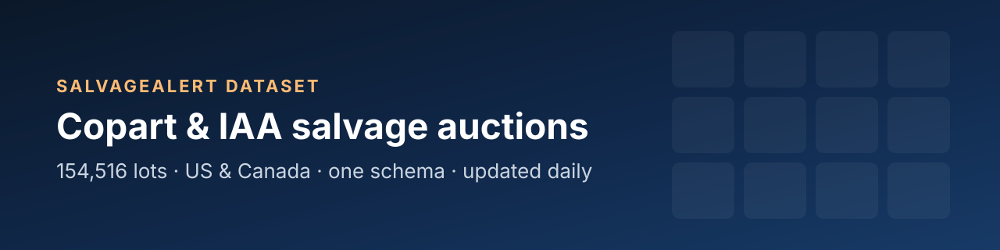

<a href="https://salvagealert.com/datasets?utm_source=github&utm_medium=dataset_readme"></a>

**Copart and IAA salvage auction lots — US and Canada — in one schema, refreshed every day.**

A free daily sample of the salvage-auction catalogue [SalvageAlert](https://salvagealert.com/?utm_source=github&utm_medium=dataset_readme) records: every lot that sold or was scheduled to sell on Copart USA, Copart Canada, IAA USA and IAA Canada, with its vehicle, condition, title, sale date and yard. One schema across all four auctions, so a Copart row and an IAA row join without mapping two feeds.

[](https://salvagealert.com/datasets?utm_source=github&utm_medium=dataset_readme)
[](#coverage)
[](data/)
[](LICENSE)

**[Build the full dataset](https://salvagealert.com/datasets?utm_source=github&utm_medium=dataset_readme)** · **[Coverage](#coverage)** · **[Fields](#fields)** · **[Load it](#load-it)** · **[Pricing](#full-dataset)** · **[Live API](https://salvagealert.com/developers?utm_source=github&utm_medium=dataset_readme)** · **[API docs](https://github.com/SalvageAlert/SalvageAlert-API-Docs)**

Contents
--------

- [What is in this repository](#what-is-in-this-repository)
- [Coverage](#coverage)
- [Fields](#fields)
- [Load it](#load-it)
- [What the sample shows](#what-the-sample-shows)
- [Use cases](#use-cases)
- [Full dataset](#full-dataset)
- [Dataset or API?](#dataset-or-api)
- [Licence](#licence)

What is in this repository
--------------------------

```
data/
├── copart_us/2026-10-24.csv     one file per auction per day,
├── copart_ca/2026-10-24.csv     the lots whose sale fell on that day
├── iaai_us/2026-10-24.csv       (up to 1,000 rows each)
└── iaai_ca/2026-10-24.csv
schema/fields.json               the schema, machine-readable
```

- **Updated daily** with the previous day's sales; the last **30 days** are kept here.
- **Today's files:** Copart USA 1,000 · Copart Canada 0 · IAA USA 0 · IAA Canada 0 rows (1,000 in all).
- Fields marked 🔒 read `[PREMIUM]` in this sample — the full VIN, prices, seller and links. Every [paid file](https://salvagealert.com/datasets?utm_source=github&utm_medium=dataset_readme) carries them.
- Every row links to its lot on SalvageAlert (`salvageAlertUrl`): photos, the sale history of the VIN and the bids.

Coverage
--------

What SalvageAlert holds today, all of which is available in the [full dataset](https://salvagealert.com/datasets?utm_source=github&utm_medium=dataset_readme):

| Auction | `source` | Lots | Sold or ended | Full VIN | Recorded since | Days in this repo |
|---|---|---:|---:|---:|---|---:|
| Copart USA | `copart_us` | 144,443 | 70,271 | 143,440 | 2026-08-16 | 1 |
| Copart Canada | `copart_ca` | 3,673 | 2,123 | 3,647 | 2026-08-16 | 0 |
| IAA USA | `iaai_us` | 3,200 | 779 | 0 | 2026-10-01 | 0 |
| IAA Canada | `iaai_ca` | 3,200 | 3,195 | 161 | 2026-09-28 | 0 |
| **All** | | **154,516** | **76,368** | **147,248** | | |

Fields
------

47 fields, the same for every auction. Dates are ISO 8601 UTC; prices are in the row's `currency` (USD or CAD).

| Field | Type | In the sample | Description |
|---|---|---|---|
| `recordId` | string | sample | Stable id of the lot across files: `<source>:<lotNumber>`. |
| `source` | string | sample | copart_us, copart_ca, iaai_us or iaai_ca. |
| `auction` | string | sample | Copart or IAA. |
| `country` | string | sample | US or CA. |
| `lotNumber` | string | sample | The auction's lot (Copart) or stock (IAA) number. |
| `vin` | string | 🔒 premium | The full 17-character VIN when we hold it unmasked, otherwise the masked VIN the auction published. The free sample shows the first 11 characters (make, model, year, plant) and masks the serial. |
| `vinIsFull` | boolean | sample | Whether `vin` is the full, unmasked VIN. |
| `year` | integer | sample | Model year. |
| `make` | string | sample | Make, as the auction spells it. |
| `model` | string | sample | Model. |
| `trim` | string | sample | Trim level, when published. |
| `bodyStyle` | string | sample | Body style. |
| `vehicleType` | string | sample | Vehicle type code or name. |
| `color` | string | sample | Exterior colour. |
| `engine` | string | sample | Engine description. |
| `cylinders` | integer | sample | Cylinder count. |
| `transmission` | string | sample | Transmission. |
| `fuelType` | string | sample | Fuel type. |
| `driveTrain` | string | sample | Drive train. |
| `odometer` | number | sample | Odometer reading. |
| `odometerUnit` | string | sample | mi or km. |
| `odometerBrand` | string | sample | Actual, not actual, exempt… as the auction states it. |
| `primaryDamage` | string | sample | Primary damage. |
| `secondaryDamage` | string | sample | Secondary damage. |
| `lossType` | string | sample | Loss type (collision, water, theft…), when published. |
| `titleType` | string | sample | Title or sale document, as published. |
| `titleState` | string | sample | State or province issuing the title. |
| `hasKeys` | boolean | sample | Keys present. |
| `runsDrives` | boolean | sample | Verified run & drive at the yard. |
| `engineStarts` | boolean | sample | Engine verified to start. |
| `saleDate` | datetime | sample | Scheduled or past sale date, UTC. |
| `saleStatus` | string | sample | `ended`, `upcoming` or `unscheduled` when the file was written. |
| `lastBid` | number | 🔒 premium | Highest bid we recorded; on an ended lot, the last bid before the sale. |
| `buyNowPrice` | number | 🔒 premium | Buy Now price, when offered. |
| `estRetailValue` | number | 🔒 premium | The auction's estimated retail (pre-loss) value. |
| `repairEstimate` | number | 🔒 premium | The auction's repair-cost estimate. |
| `currency` | string | sample | USD or CAD — the currency of every price in the row. |
| `sellerName` | string | 🔒 premium | Seller (insurer, lender, fleet…), when published. |
| `sellerType` | string | sample | insurance, dealer, rental, finance, government, charity or other. |
| `yard` | string | sample | Selling yard or branch. |
| `yardState` | string | sample | Two-letter state or province of the yard. |
| `yardZip` | string | sample | Postal code of the yard, when published. |
| `imageUrl` | string | 🔒 premium | Lead photo URL. |
| `listingUrl` | string | 🔒 premium | The listing on the auction's own site. |
| `salvageAlertUrl` | string | sample | The lot on SalvageAlert: photos, sale history and the VIN record. |
| `firstSeenAt` | datetime | sample | When SalvageAlert first recorded the lot, UTC. |
| `lastSeenAt` | datetime | sample | When SalvageAlert last refreshed the lot, UTC. |

Load it
-------

**pandas**

```python
import glob, pandas as pd

df = pd.concat(map(pd.read_csv, glob.glob("data/*/*.csv")), ignore_index=True)
print(df.groupby(["auction", "country"]).size())
print(df[df.runsDrives == True].groupby("make").size().nlargest(10))
```

**DuckDB**

```sql
SELECT auction, primaryDamage, count(*) AS lots
FROM read_csv_auto('data/*/*.csv')
GROUP BY ALL
ORDER BY lots DESC
LIMIT 20;
```

What the sample shows
---------------------

From today's 1,000 rows:

**Top makes**

```
FORD                   ████████████████████████ 121
TOYOTA                 █████████████████████ 108
CHEVROLET              ████████████████████ 99
NISSAN                 ████████████████ 82
HONDA                  ██████████████ 71
HYUNDAI                ███████████ 57
KIA                    ██████████ 52
DODGE                  ████████ 38
```

**Primary damage**

```
FRONT END              ████████████████████████ 527
SIDE                   ███████ 147
REAR END               ██████ 129
HAIL                   █ 28
BURN                   █ 26
ALL OVER               █ 21
ROLLOVER               █ 21
MINOR DENT/SCRATCHES   █ 18
```

**Title**

```
Salvage                ████████████████████████ 861
None                   ███ 97
PartsOnly              █ 29
Rebuilt                █ 12
```

**Seller type**

```
insurance              ████████████████████████ 300
rental                 █ 2
dealer                 █ 1
finance                █ 1
```


Use cases
---------

- **Salvage value models** — price a repairable car from what comparable lots made (full dataset: last bid, retail value, repair estimate).
- **Market research** — damage mix, title brands and run-and-drive rates by make, region and auction.
- **Parts sourcing** — where the donor cars for a model are, and how often they come up.
- **Research and teaching** — a clean, documented, real-world dataset of the US and Canadian salvage market.

Full dataset
------------

The whole catalogue — 154,516 lots and growing — with every field unmasked, filtered to what you need:

1. Open **[salvagealert.com/datasets](https://salvagealert.com/datasets?utm_source=github&utm_medium=dataset_readme)** and pick the auctions, the period, makes, years and status.
2. See the row count and the price as you go; download a **free 100-row preview** of exactly that selection.
3. Pay once. The file (CSV or JSON Lines, gzip) is ready within minutes.

| Rows in the order | Price per 1,000 rows |
|---|---:|
| 1 – 100,000 | $0.50 |
| 100,001 – 500,000 | $0.40 |
| 500,001 – 2,000,000 | $0.30 |
| above 2,000,000 | $0.20 |

| Example order | Price |
|---|---:|
| 10,000 rows | **$5** |
| 100,000 rows | **$50** |
| 1,000,000 rows | **$360** |
| 3,000,000 rows | **$860** |

Each band is priced on its own, so adding rows never raises the price per row. Minimum order $5. No subscription. Full archives and recurring deliveries: [contact us](https://salvagealert.com/contact?utm_source=github&utm_medium=dataset_readme).

Dataset or API?
---------------

| | Dataset | API |
|---|---|---|
| What | A file of past and current lots | Live queries against the catalogue |
| Paid | Once, per row | Per call, in credits, with a monthly allowance |
| Best for | Analysis, models, research | Apps, alerts, dashboards that need today's lots |
| Start | [salvagealert.com/datasets](https://salvagealert.com/datasets?utm_source=github&utm_medium=dataset_readme) | [salvagealert.com/developers](https://salvagealert.com/developers?utm_source=github&utm_medium=dataset_readme) · [docs repo](https://github.com/SalvageAlert/SalvageAlert-API-Docs) |

Licence
-------

The sample in this repository is free for research and non-commercial use under [CC BY-NC 4.0](LICENSE), with attribution to **SalvageAlert (salvagealert.com)**. Commercial use needs a [paid dataset](https://salvagealert.com/datasets?utm_source=github&utm_medium=dataset_readme), which licenses use inside the buyer's organisation.

```bibtex
@misc{salvagealert_dataset,
  title  = {SalvageAlert salvage auction dataset: Copart and IAA, US and Canada},
  author = {SalvageAlert},
  year   = {2026},
  url    = {https://github.com/SalvageAlert/SalvageAlert-auctions-dataset}
}
```

---

<a href="https://salvagealert.com/?utm_source=github&utm_medium=dataset_readme"><b>SalvageAlert</b></a> — every IAA and Copart salvage auction, watched for you.
[Browse lots](https://salvagealert.com/lots?utm_source=github&utm_medium=dataset_readme) · [VIN check](https://salvagealert.com/vin-check?utm_source=github&utm_medium=dataset_readme) · [Datasets](https://salvagealert.com/datasets?utm_source=github&utm_medium=dataset_readme) · [API](https://salvagealert.com/developers?utm_source=github&utm_medium=dataset_readme) · [Pricing](https://salvagealert.com/pricing?utm_source=github&utm_medium=dataset_readme)

<sub>SalvageAlert is an independent service and is not affiliated with, endorsed by or a partner of Copart, Inc. or IAA, Inc. Copart and IAA are trademarks of their owners. Data is recorded from the auctions' public listings.</sub>
